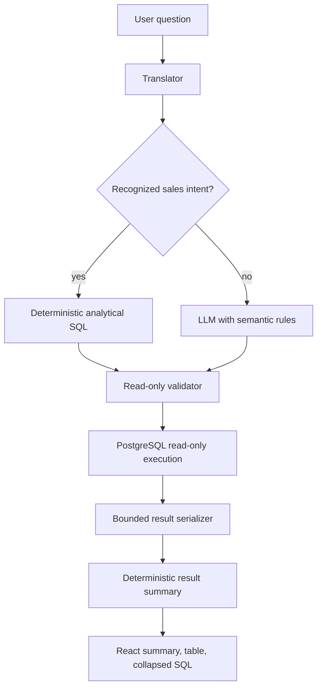

# Analytical Chat Queries Design

**Spec**: `.specs/features/analytical-chat-queries/spec.md`
**Status**: Approved

---

## Architecture Overview

The feature adds a deterministic fast path for the supported sales questions,
strengthens the fallback system prompt, and keeps the existing LLM and
read-only validation path for everything else. Result summaries are generated
from serialized database rows rather than from model text.



## Code Reuse Analysis

| Existing component | Location | Use |
| --- | --- | --- |
| Prompt builder | `core/prompter.py` | Add the business glossary and SQL rules used by the LLM fallback. |
| Translator JSON parser | `core/translator.py` | Select deterministic queries before calling Ollama and preserve the existing response contract. |
| Read-only query validation | `database/predefined_queries.py` and `api/services/chat.py` | Keep the existing single-statement safety boundary. |
| Result serialization | `api/serializers/results.py` | Add bounded, JSON-safe summary generation beside serialization. |
| Chat response schema | `api/schemas/chat.py` | Expose the optional summary without changing existing result fields. |
| React chat state | `web/src/features/chat/useChat.ts` | Carry the summary and automatic execution response. |
| React result rendering | `web/src/features/chat/ChatWorkspace.tsx` | Render summary and collapsed SQL details without duplicating timeline items. |

## Components

### Sales intent recognizer and query builder

- **Purpose**: Recognize the supported Portuguese revenue and product-sales
  questions and produce parameterized, read-only SQL with a complete date
  interval.
- **Location**: `core/analytical_queries.py`
- **Interface**:
  - `build_known_query(question: str, reference_date: date | None = None) ->
    Optional[AnalyticalQuery]`
- **Dependencies**: Python standard library only.
- **Reuses**: Existing PostgreSQL table and column names from the live schema.

### Semantic prompt rules

- **Purpose**: Prevent the LLM fallback from repeating the observed status,
  grouping, date, and metric mistakes.
- **Location**: `core/prompter.py`
- **Interface**: Existing `build_system_prompt`.
- **Dependencies**: Existing live schema and local context files.

### Deterministic result summary

- **Purpose**: Derive truthful summaries from returned rows and bounded result
  metadata.
- **Location**: `api/serializers/results.py`
- **Interface**:
  - `summarize_result(result: ResultPayload) -> str`
- **Dependencies**: Existing result payload.

### API and React response wiring

- **Purpose**: Expose the summary, execute normal chat requests automatically,
  and render the summary before the table while keeping SQL accessible.
- **Locations**: `api/services/chat.py`, `api/schemas/chat.py`,
  `web/src/api/client.ts`, `web/src/features/chat/useChat.ts`,
  `web/src/features/chat/ChatWorkspace.tsx`.
- **Dependencies**: Existing chat persistence and API client.

## Data Models

```python
class AnalyticalQuery(TypedDict):
    sql: str
    parameters: dict[str, object]
    intent: str
```

```typescript
interface ChatSummary {
  text: string;
}
```

The summary is optional for backward compatibility. Query parameters are stored
with the existing assistant metadata and bound by the existing execution path.

## Error Handling Strategy

| Scenario | Handling | User impact |
| --- | --- | --- |
| Unsupported question | Existing LLM fallback | Broad behavior remains available. |
| Invalid date phrase | Fall back without fabricating a date | User receives the existing model response or warning. |
| Invalid generated SQL | Existing read-only rejection | No database execution; retry remains available. |
| Database failure | Existing retryable API error | User can retry without duplicating the request. |
| Empty/non-numeric summary metrics | Generic truthful summary | No fabricated totals. |

## Risks & Concerns

| Concern | Location | Impact | Mitigation |
| --- | --- | --- | --- |
| LLM can still produce semantically wrong fallback SQL | `core/translator.py` | Unsupported questions may remain imperfect | Add explicit business rules and keep deterministic fast paths for the observed intents. |
| Current review mode is the default in the React hook | `web/src/features/chat/useChat.ts` | Extra round trip remains if app wiring is missed | Set automatic mode explicitly at `AuthenticatedApp` and cover it in E2E. |
| Header totals and item subtotals differ in existing data | PostgreSQL data, not code | A combined metric could mislead users | Keep receipt and item metrics separate and document reconciliation as deferred. |
| Summaries can become misleading when result rows are truncated | `api/serializers/results.py` | Summary may describe only a bounded subset | Mark summaries as bounded when `truncated` is true. |
| Existing frontend tests assume manual review | `web/e2e/chat.spec.ts` | Contract change can cause regressions | Update the E2E fixture to cover automatic execution and preserve an explicit review test. |

## Tech Decisions

| Decision | Choice | Rationale |
| --- | --- | --- |
| Common-intent handling | Deterministic SQL fast path before Ollama | Correctness and latency matter more than asking the model to rediscover fixed schema relationships. |
| Summary generation | Deterministic from result rows | Prevents hallucinated totals and keeps output reproducible. |
| Review compatibility | Keep `review_mode` API flag | Existing callers and explicit review workflows remain supported. |
