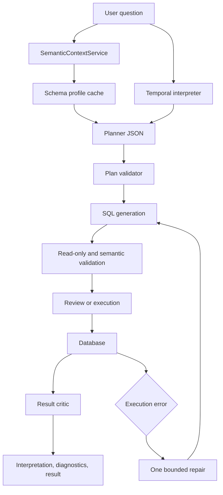

# Analytical Query Intelligence Design

**Spec**: `.specs/features/analytical-query-intelligence/spec.md`
**Context**: `.specs/features/analytical-query-intelligence/context.md`
**Status**: Approved

## Architecture Overview

The selected architecture is an in-process semantic layer enriching the
existing staged chat pipeline. It is not a new deployed service.



### Chosen Approach

The pipeline keeps the current FastAPI, Ollama, repository, and React
boundaries. It adds typed internal contracts instead of introducing a new
network service or domain-specific query library.

### Alternatives Rejected

| Approach | Trade-off | Decision |
| --- | --- | --- |
| Single enriched model call | Lower latency but no independently testable plan or semantic boundary | Rejected |
| Separate semantic microservice | Strong isolation but adds deployment, cache invalidation, and failure modes | Rejected for this feature |
| In-process semantic layer plus staged pipeline | Reuses existing boundaries, supports cache invalidation, and keeps each step testable | Selected |

## Code Reuse Analysis

| Existing component | Location | Reuse |
| --- | --- | --- |
| Live PostgreSQL introspection | `database/postgres.py` | Extend metadata queries and preserve `get_schema_info`. |
| Prompt composition | `core/prompter.py` | Add planner and SQL-generation prompt builders. |
| Ollama integration | `core/translator.py` | Preserve response cleaning and add typed planning stages. |
| Chat orchestration | `api/services/chat.py` | Add plan validation, bounded repair, and result diagnostics. |
| Read-only guard | `database/predefined_queries.py` | Reuse for generated, repaired, and stored SQL. |
| Existing API response | `api/schemas/chat.py` | Extend with optional interpretation and diagnostics. |
| Stable message rendering | `web/src/features/chat/useChat.ts` | Store interpretation on the same assistant message. |
| Existing test commands | `pytest`, `npm --prefix web` | Preserve current gates. |

## Components

### SemanticContextService

- **Purpose**: Build and cache a structured, domain-neutral profile of the
  current database.
- **Location**: `core/semantic_context.py` and `api/dependencies.py`.
- **Interfaces**:
  - `get_profile() -> SemanticProfile`
  - `invalidate() -> None`
- **Dependencies**: `DatabaseAdapter`.
- **Reuses**: PostgreSQL introspection and existing schema synchronization.

### TemporalInterpreter

- **Purpose**: Convert supported Portuguese temporal expressions into explicit
  date ranges and planning hints.
- **Location**: `core/temporal.py`.
- **Interface**:
  - `interpret(question: str, reference_date: date) -> TemporalInterpretation`.
- **Dependencies**: Python `datetime` and regular expressions only.
- **Reuses**: The reference-date behavior already passed to `Prompter`.

### QueryPlan and Planner

- **Purpose**: Separate analytical intent from SQL rendering.
- **Location**: `core/query_plan.py`, `core/prompter.py`, and
  `core/translator.py`.
- **Interfaces**:
  - `plan_question(...) -> QueryPlan`.
  - `translate_plan_to_sql(plan, ...) -> TranslationPayload`.
- **Dependencies**: Ollama and `SemanticProfile`.
- **Reuses**: Existing conversation context and JSON cleanup.

### PlanValidator

- **Purpose**: Reject unknown identifiers and invalid plan references before
  SQL execution.
- **Location**: `core/query_validation.py`.
- **Interfaces**:
  - `validate_plan(plan, profile) -> None`.
  - `validate_sql(sql) -> str`.
- **Dependencies**: `SemanticProfile` and read-only validator.
- **Reuses**: `PredefinedQueryRepository.validate_query`.

### ExecutionFeedback and ResultCritic

- **Purpose**: Perform one bounded repair after an execution failure and attach
  truthful diagnostics to valid results.
- **Location**: `api/services/chat.py` and `core/result_quality.py`.
- **Interfaces**:
  - `repair_query(...) -> TranslationPayload`.
  - `criticize(result, plan) -> ResultDiagnostics`.
- **Dependencies**: Database adapter, translator, and query plan.
- **Reuses**: Stored SQL persistence, retry metadata, and result serializer.

### Interpretation UI

- **Purpose**: Show intent, assumptions, and diagnostics with the existing
  assistant response.
- **Location**: `web/src/features/chat/useChat.ts`,
  `web/src/features/chat/ChatWorkspace.tsx`.
- **Dependencies**: Extended `ChatResponse`.
- **Reuses**: Stable message replacement and existing result/insight regions.

### Evaluation Harness

- **Purpose**: Compare query quality without hard-coded business queries.
- **Location**: `evaluation/query_benchmark.py` and
  `evaluation/test_query_benchmark.py`.
- **Interface**:
  - `evaluate_cases(cases, results) -> BenchmarkReport`.
- **Dependencies**: Python standard library only.
- **Reuses**: Result payload shape and documented test commands.

## Data Models

```python
@dataclass(frozen=True)
class SemanticProfile:
    tables: dict[str, "TableProfile"]
    relationships: tuple["RelationshipProfile", ...]
    generated_at: datetime
```

```python
@dataclass(frozen=True)
class QueryPlan:
    intent: str
    tables: tuple[str, ...]
    relationships: tuple[str, ...]
    dimensions: tuple[str, ...]
    metrics: tuple[str, ...]
    filters: tuple[dict[str, object], ...]
    grain: str | None
    assumptions: tuple[str, ...]
```

```python
class ResultDiagnostics(TypedDict):
    kind: Literal["none", "empty_result", "missing_expected_columns"]
    message: str
    expected_columns: list[str]
```

The API keeps `interpretation` and `diagnostics` optional so existing clients
remain compatible while the frontend adopts the new fields.

## Error Handling Strategy

| Scenario | Handling | User impact |
| --- | --- | --- |
| Profile refresh fails | Log and return a stable schema synchronization error | Existing sync error remains visible. |
| Planner returns malformed JSON | Persist a retryable translation error | User can retry without a duplicate turn. |
| Unknown plan identifier | Reject before database execution | Clear validation message, no SQL execution. |
| Database rejects SQL | Attempt one validated repair | User sees repaired result or one retryable failure. |
| Repair fails | Preserve the assistant message and error metadata | No loop and no duplicate message. |
| Valid zero-row result | Return result plus diagnostic | User sees that no matching rows were found. |
| Result misses expected columns | Return result plus diagnostic | User sees incomplete answer instead of fabricated values. |

## Risks & Concerns

| Concern | Location | Impact | Mitigation |
| --- | --- | --- | --- |
| Schema cache can become stale | `api/dependencies.py` | New tables may not be planned until refresh | Clear cache through `/api/schema/sync`; include profile timestamp. |
| Current translator wraps all exceptions broadly | `core/translator.py` | Planner and SQL-stage failures can lose precise cause | Add stage-specific error metadata while preserving public error shape. |
| Conversation context is limited to six turns | `api/services/chat.py` | Long analytical follow-ups can lose assumptions | Persist the structured plan in message metadata and include it on retries. |
| Existing result critic has no expected-column contract | `api/services/chat.py` | Missing requested measures can pass as valid | Compare result columns to plan metrics/dimensions. |
| PostgreSQL adapter is the only concrete schema profiler | `database/postgres.py` | Other adapters may not expose rich metadata | Keep the base interface backward-compatible and make profile fields optional. |
| More LLM calls increase latency | `core/translator.py` | User waits longer for complex questions | Bound stages, expose progress text, and benchmark latency. |

## Tech Decisions

| Decision | Choice | Rationale |
| --- | --- | --- |
| Semantic layer deployment | In-process service with explicit invalidation | Adds capability without operational infrastructure. |
| Inter-stage contract | Typed dataclasses normalized from JSON | Keeps malformed model output out of service logic. |
| Repair bound | One attempt | Prevents loops and makes latency predictable. |
| Raw data exposure | No rows or unmasked examples in prompts | Preserves database privacy and plug-in safety. |

