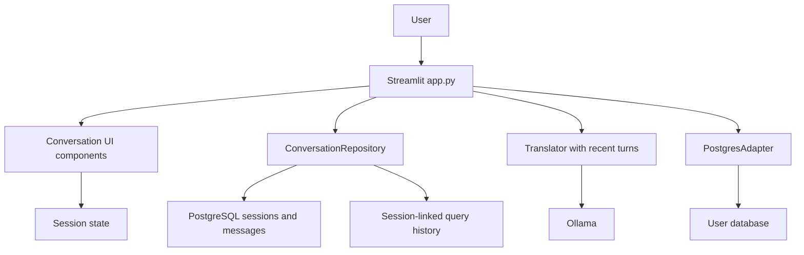

# Chat UX and Interaction Stability Design

**Spec**: `.specs/features/chat-ux-stability/spec.md`
**Status**: In Progress

---

## Architecture Overview

Keep Streamlit. The visible duplication comes from drawing a submitted prompt inline and then rendering it again from `st.session_state.messages` after a rerun. Make the message/session store the source of truth and render it once per run. Add a PostgreSQL conversation repository for durable, user-owned sessions. The translator receives a bounded context from the active session. The sidebar becomes the navigation surface for sessions and existing tools.

Each action has one request UUID. User and assistant messages use that UUID with a role-specific uniqueness constraint, so reruns cannot persist the same turn twice. A new draft has no database row until the first prompt. Failed prompts remain in the saved session with their error; query result rows remain only in the active Streamlit session and are never stored in conversation tables.

On session-history reads, the repository first removes non-favorite sessions owned by the current user whose `last_activity` is at least one year old. Foreign session IDs never load, update, favorite, or delete data. The existing query-history table gains a nullable session relationship: new query records are scoped to a session, and deleting/expiring that session cascades only to linked query records. Existing records remain unlinked and continue to work as before.

---

## Code Reuse Analysis

### Existing Components to Leverage

| Component | Location | How to Use |
| --- | --- | --- |
| Streamlit cached service construction and authentication gate | `app.py` | Retain the existing DB, auth, translator, profile, role, and catalog setup. Add the conversation repository alongside current repositories. |
| Chat message, result, chart, download rendering | `components.py` | Extend the existing renderer to display persisted message fields and active-only DataFrames without duplicating the chat loop. |
| Query history ownership and operations | `database/query_history.py` | Keep its current per-user behavior; add nullable session linkage and scoped deletion for linked entries. |
| Database adapter transaction and query helpers | `database/postgres.py` | Reuse parameterized SQL and transactional `execute_command` for schema and data operations. |
| Natural-language SQL translation | `core/translator.py` | Extend `translate_to_sql` with an optional bounded conversation context; retain current stateless behavior when context is absent. |
| Shared-query catalog and user administration | `app.py`, `database/predefined_queries.py`, `database/users.py` | Preserve role checks and current operations while reorganizing sidebar sections. |

### Integration Points

| System | Integration Method |
| --- | --- |
| Streamlit session state | Store the active session ID, message transcript, pending action, and a UUID for each turn. Render messages from one canonical list. |
| PostgreSQL | Add conversation-session and conversation-message tables. Scope all repository methods by authenticated user ID. |
| Query history | Add a nullable foreign key to conversation sessions. Include the active session ID when recording queries; leave old records null. |
| Ollama | Supply at most the six latest completed user/assistant turns before the current prompt. Do not include result rows. |

---

## Components

### ConversationRepository

- **Purpose**: Persist, load, favorite, expire, and delete a user's conversation sessions and messages.
- **Location**: `database/conversations.py`
- **Interfaces**:
  - `initialize()` - create session/message tables and indexes.
  - `list_sessions(user_id)` - purge that user's expired non-favorites, then return their sessions ordered by favorite and activity.
  - `create_with_user_message(user_id, session_id, request_id, prompt)` - atomically create a session and its first user message.
  - `append_message(user_id, session_id, request_id, role, content, sql=None, error=None, metadata=None)` - owner-scoped, idempotent message insert and activity update.
  - `get_messages(user_id, session_id)` - load one owner's ordered transcript.
  - `get_context(user_id, session_id, limit=6)` - return the latest completed prompt/assistant/SQL turns.
  - `set_favorite(user_id, session_id, favorite)` - update only an owned session.
  - `delete(user_id, session_id)` - delete only an owned session; database cascades its messages and linked query-history rows.
- **Dependencies**: `PostgresAdapter`, UUID request/session IDs, JSON serialization for message metadata.
- **Reuses**: Existing parameterized SQL and transaction handling in `PostgresAdapter`.

### QueryHistoryRepository integration

- **Purpose**: Preserve executed-query history while associating new entries with their conversation.
- **Location**: `database/query_history.py`
- **Interfaces**:
  - Extend `record(..., session_id=None)` to scope de-duplication by owner, session, SQL, and parameters.
  - Add `session_id` to returned records where present.
- **Dependencies**: Conversation session table must be initialized before adding the foreign key.
- **Reuses**: Existing user-scoped history list, pin, and delete behavior. Null-linked legacy rows are unchanged.

### Translator conversation context

- **Purpose**: Make a resumed conversation's recent turns available to SQL generation without unbounded prompt growth.
- **Location**: `core/translator.py`
- **Interfaces**:
  - Extend `translate_to_sql(user_question, conversation_context=None)` where context is an ordered list of Ollama-compatible user/assistant messages.
- **Dependencies**: `ConversationRepository.get_context`.
- **Reuses**: Current system prompt, model selection, Ollama call, and JSON response parser.

### Streamlit session and layout

- **Purpose**: Keep one canonical render path for messages and provide session navigation without removing existing tools.
- **Location**: `app.py`, `components.py`
- **Interfaces**:
  - Initialize a blank draft and active session state after authorization.
  - Render a grouped, user-scoped session list, New conversation action, favorite action, and confirmed delete action.
  - Route prompt submission, SQL review, query execution, retry, and history re-execution through one action-state path.
  - Render each stored message once; render a result DataFrame only for the active runtime result.
- **Dependencies**: Conversation and query-history repositories; current auth/profile and DB services.
- **Reuses**: Existing login/signup forms, role checks, shared queries, query-history actions, charts, and CSV download code.

### UI regression tests

- **Purpose**: Verify state transitions, rendering-once behavior, access scoping, persistence, and visual structure against the acceptance criteria.
- **Location**: `test_conversations.py`, `test_translator.py`, and focused app/component tests.
- **Dependencies**: pytest, mocks for PostgreSQL/Ollama, and Streamlit's built-in testing support if supported by the installed version.
- **Reuses**: Existing pytest and `unittest.mock` patterns.

---

## Data Models

### Conversation session

| Field | Type | Rules |
| --- | --- | --- |
| `id` | UUID | Generated by the application; primary key. |
| `user_id` | UUID | Required FK to `auth.users(id)` with cascade on account deletion. |
| `title` | TEXT | First prompt trimmed for display. |
| `is_favorite` | BOOLEAN | Defaults to false; favorites are not automatically expired. |
| `created_at` | TIMESTAMPTZ | Database-generated. |
| `last_activity` | TIMESTAMPTZ | Updated when a user or assistant message is appended. |

### Conversation message

| Field | Type | Rules |
| --- | --- | --- |
| `id` | BIGSERIAL | Primary key; determines stable message order. |
| `session_id` | UUID | Required FK to session with cascade delete. |
| `request_id` | UUID | Identifies one submitted turn. |
| `role` | TEXT | `user` or `assistant`. |
| `content` | TEXT | Prompt, assistant status, or error text. |
| `sql` | TEXT | Nullable generated/executed SQL. |
| `error` | TEXT | Nullable failure text. |
| `metadata` | JSONB | Nullable chart configuration and non-result display metadata. |
| `created_at` | TIMESTAMPTZ | Database-generated. |

**Uniqueness**: `(session_id, request_id, role)` prevents duplicate persistence of either side of a turn.

### Query history relationship

Add nullable `session_id UUID REFERENCES ask_sql_conversation_sessions(id) ON DELETE CASCADE`. Existing rows remain null. New records de-duplicate within the same user and session, preventing a later session from replacing the relationship of an earlier one.

---

## Error Handling Strategy

| Error Scenario | Handling | User Impact |
| --- | --- | --- |
| Conversation table initialization or save fails | Log the exception and show an explicit persistence error; do not show a saved state. | User can see the failure and retry or copy the prompt. |
| Session ID is missing, expired, or owned by another user | Repository returns no record/change; app displays a neutral unavailable-session message and opens a new draft. | No foreign content or changes are exposed. |
| Translation fails | Persist one assistant error against the prompt; expose a safe translation retry action. | Transcript remains complete and retry is explicit. |
| Query execution fails | Persist SQL and error once; only offer repeat execution when the query is classified as safe to retry. | Failure is visible without silently replaying work. |
| Query-history write fails after query success | Keep the successful result and show/log the history-write failure separately. | Query result is not misrepresented as failed. |
| Expiry deletion fails | Surface the error and do not claim cleanup succeeded; do not hide/delete session data in memory. | User sees the history operation failed. |

---

## Risks & Concerns

| Concern | Location (file:line) | Impact | Mitigation |
| --- | --- | --- | --- |
| Prompt is rendered inline and then through stored history after rerun. | `app.py:400`, `app.py:411`, `app.py:416` | Duplicate-looking chat and flashes. | Remove the inline duplicate render; write to canonical state before a rerun and render the transcript from one loop. |
| Query history currently deduplicates without a session relationship. | `database/query_history.py:61`, `database/query_history.py:68` | A query used in a second session could overwrite the session link of the first. | Include nullable `session_id` in the deduplication predicate; preserve null-linked legacy entries. |
| No chat-level persistence or UI regression tests exist. | `app.py`, `components.py` | State/rerun regressions can escape repository-only tests. | Add deterministic tests for repository operations, turn idempotency, translator context, and render count/state. |
| Expiry needs no external scheduler under the accepted policy. | `database/conversations.py` (new) | Inactive rows remain until the owner next opens history. | Make expiry cleanup part of each session-list request and state that timing in the UI/help text. |
| The worktree contains pre-existing staged changes in files this feature must extend. | `app.py`, `components.py`, `database/query_history.py`, `requirements.txt` | A commit could accidentally include unrelated user-staged work. | Preserve the initial index and avoid committing unrelated changes; stop for user guidance if an atomic commit cannot exclude the pre-existing staged hunks safely. |
| SQL execution can fail after a prompt has been saved. | `app.py` query flow | Replaying unsafe SQL could duplicate effects. | Keep retry explicit and restrict execution retry to read-only SQL; never automatically retry login, registration, or admin mutations. |

---

## Tech Decisions

| Decision | Choice | Rationale |
| --- | --- | --- |
| Frontend | Keep Streamlit and use native components plus scoped CSS. | The duplicate display is caused by the current rendering flow, not evidence that Streamlit cannot support the requested UX. |
| Session persistence | Add PostgreSQL tables owned by the authenticated user. | The app already uses PostgreSQL and auth UUIDs; session content must survive a browser/app reload. |
| Result data | Do not persist query rows. | Prevents large/sensitive result snapshots from being copied into conversation history; users can explicitly execute stored SQL again. |
| Expiry execution | Delete stale sessions when the current user's session list is requested. | Matches the user's accepted next-visit purge without introducing an unsupported scheduler. |
| UI automation | Use installed Streamlit testing support if available; otherwise test the extracted state/render helpers with the existing pytest stack. | Avoid adding frontend tooling or dependencies only to test this change. |

> **Project-level decisions:** None. These choices are specific to conversation history and this UI redesign.
