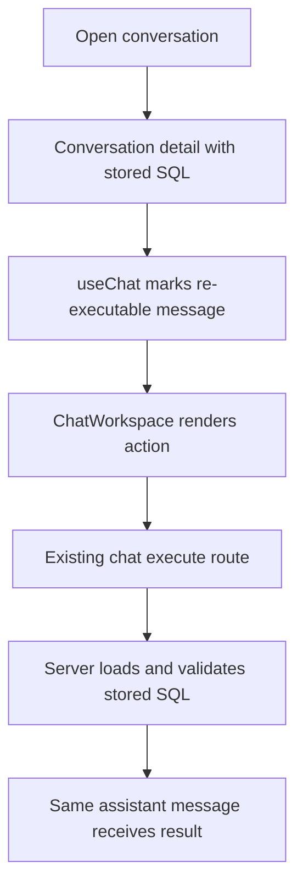

# Conversation Query Re-execution Design

**Spec**: `.specs/features/conversation-query-reexecution/spec.md`
**Status**: Approved

## Architecture

The backend already exposes the correct operation. The change is limited to
the restored-message state and its presentation.

## Components

### Restored message mapping

- **Location**: `web/src/features/chat/useChat.ts`
- **Change**: Set an explicit `reexecuteAvailable` marker for restored
  assistant messages with SQL that are not already retryable failures.
- **Safety**: Do not copy SQL into any request payload.

### Execution action

- **Location**: `web/src/features/chat/ChatWorkspace.tsx`
- **Change**: Render the stored SQL and a `Reexecutar consulta` button when the
  marker is present and the message has no current result.
- **Reuse**: Call the existing `onConfirmExecution`, which already invokes
  `client.chat.execute` with identifiers only.

### Verification

- Unit tests cover restored state and action behavior.
- The existing parity E2E scenario is extended to click the action and mock
  stored-query execution.

## Error Handling

The existing `useChat` request guard and error mapping remain authoritative.
Execution failures keep the same assistant message, mark it retryable, and
expose `Tentar novamente`.
