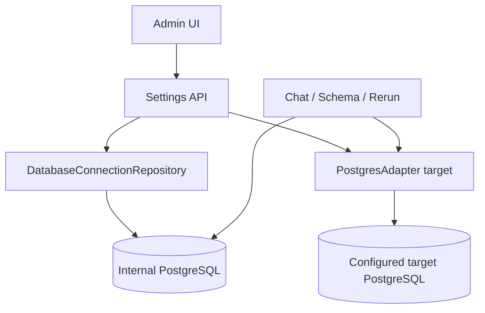

# Configuração da conexão do banco consultado Design

**Spec:** `.specs/features/database-connection-settings/spec.md`
**Status:** Approved

## Architecture Overview

O banco definido por `DATABASE_URL` continua sendo o banco interno da
aplicação. Um novo repositório guarda uma única connection string do banco-alvo
em formato cifrado. O adaptador do banco-alvo é criado sob demanda e separado
dos repositórios de perfis, conversas, histórico e catálogo.



## Code Reuse Analysis

### Existing Components to Leverage

| Component | Location | How to Use |
| --- | --- | --- |
| SQLAlchemy PostgreSQL adapter | `database/postgres.py` | Add an explicit connection-string constructor path for the target adapter. |
| Lazy database dependency | `api/dependencies.py` | Keep the internal adapter cached and add a target adapter dependency with explicit missing-configuration errors. |
| Admin role guard | `api/dependencies.py` | Protect both target status and write endpoints with `require_roles("admin")`. |
| Settings panel navigation | `web/src/app/AuthenticatedApp.tsx` | Keep the existing panel and add the admin-only connection form beside schema synchronization. |
| API client request/error handling | `web/src/api/client.ts` | Add typed settings methods using the existing cookie and `ApiError` behavior. |

### Integration Points

| System | Integration Method |
| --- | --- |
| Internal database | `get_db_adapter()` remains the source for application repositories and configuration storage. |
| Target database | `get_target_db_adapter()` resolves the encrypted global configuration and returns a separate `PostgresAdapter`. |
| Schema cache | Saving a target clears `get_target_db_adapter`, `get_semantic_context`, and `get_translator` caches. |
| Query execution | Chat, history rerun, predefined execution, and schema synchronization receive the target adapter. |

## Components

### Encrypted target connection repository

- **Purpose:** Create the configuration table in the internal database and save,
  retrieve, and report the single encrypted target connection.
- **Location:** `database/database_connections.py`
- **Interfaces:**
  - `get_status() -> dict` - returns only configured state and update metadata.
  - `get_connection_string() -> Optional[str]` - decrypts server-side for the
    target dependency.
  - `save(connection_string, updated_by) -> None` - stores encrypted data.
- **Dependencies:** SQLAlchemy adapter, `SESSION_SECRET`, Fernet encryption.
- **Reuses:** Existing repository `execute_query` and `execute_command` pattern.

### Target adapter dependency

- **Purpose:** Resolve the active target connection and keep target operations
  separate from application persistence.
- **Location:** `api/dependencies.py`
- **Interfaces:** `get_target_db_adapter() -> PostgresAdapter`.
- **Dependencies:** Internal adapter, connection repository, application settings.
- **Reuses:** Existing `lru_cache` dependency factories and `APIError`.

### Database settings API

- **Purpose:** Expose admin-only status and test-and-save operations.
- **Location:** `api/routes/database_settings.py`,
  `api/schemas/database_settings.py`
- **Interfaces:**
  - `GET /api/settings/database`
  - `PUT /api/settings/database`
- **Dependencies:** Current session/role guard, connection repository, target
  adapter constructor.
- **Reuses:** Existing stable API error shape and route tests.

### Database connection settings panel

- **Purpose:** Let an admin enter and save a connection string without exposing
  the saved secret.
- **Location:** `web/src/features/settings/DatabaseConnectionSettings.tsx`
- **Interfaces:** `client.settings.database.get()` and
  `client.settings.database.save(connectionString)`.
- **Dependencies:** Existing `ApiClient`, React state, settings panel styles.
- **Reuses:** Feedback and duplicate-submit behavior from
  `SyncDatabaseButton`.

## Data Models

### Database connection status

```python
class DatabaseConnectionStatus:
    configured: bool
    updated_at: Optional[str]
```

The API never includes the connection string.

### Stored connection

```text
id SMALLINT PRIMARY KEY CHECK (id = 1)
encrypted_connection_string TEXT NOT NULL
updated_by UUID
updated_at TIMESTAMPTZ NOT NULL
```

The `encrypted_connection_string` is generated with Fernet using a key derived
from `SESSION_SECRET`.

## Error Handling Strategy

| Error Scenario | Handling | User Impact |
| --- | --- | --- |
| Missing target configuration | `503 database_not_configured` from target-required operations | Admin sees that a target must be configured; health and internal persistence remain available. |
| Invalid PostgreSQL string | `422 validation_error` | The form remains editable and no value is saved. |
| Target `SELECT 1` fails | `503 database_connection_failed` | The prior connection remains active and the error is shown without database details. |
| Non-admin status or save | `403 forbidden` | The operation is rejected server-side. |
| Corrupt encrypted value | `503 database_configuration_invalid` and an error log without the secret | Target operations fail explicitly instead of using a fallback. |

## Risks & Concerns

| Concern | Location | Impact | Mitigation |
| --- | --- | --- | --- |
| The current adapter is used for both app persistence and queries | `api/dependencies.py:33-99` | A global replacement could break authentication and history | Keep the internal dependency and add a separate target dependency. |
| A target credential is a high-value secret | New connection repository | Plaintext storage or API echo would expose the database | Fernet encryption, admin-only endpoints, no secret in response/logs, and password-style input. |
| Cached translator/schema state can keep the old target | `api/dependencies.py:62-96` | Saving a new connection would not affect the next query | Clear target, semantic, and translator caches after a successful save. |
| Existing repository initialization is not automatic | `database/*.py` | The new configuration table may not exist in a fresh internal database | Initialize the new repository lazily on first settings/target use with explicit errors. |
| No target connection is valid during initial setup | `database/postgres.py:28-43` | Query dependencies could fail with generic errors | Return a stable `503 database_not_configured` before constructing a target adapter. |

## Tech Decisions

| Decision | Choice | Rationale |
| --- | --- | --- |
| Credential encryption | Fernet with a key derived from `SESSION_SECRET` | Provides authenticated symmetric encryption without exposing the target secret to the client. |
| Target storage | Single-row internal database table | Matches the confirmed global-admin scope and avoids a new persistence service. |
| Save semantics | Test before write | Prevents replacing a working target with an unreachable connection. |
