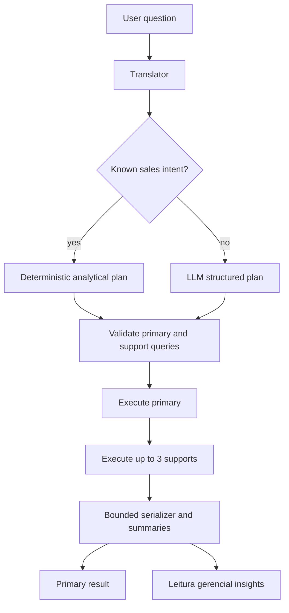

# Managerial Analytical Planner Design

**Spec**: `.specs/features/managerial-analytical-planner/spec.md`
**Status**: Approved

## Architecture Overview

The planner preserves the existing primary `result` contract and adds optional
supporting insights. Known sales intents are planned deterministically; the
fallback LLM may provide a structured supporting-query list constrained by the
live schema and read-only validator.



## Code Reuse Analysis

| Existing component | Location | How to use |
| --- | --- | --- |
| Analytical query builder | `core/analytical_queries.py` | Extend its period resolver and return a plan. |
| Prompt builder | `core/prompter.py` | Specify structured supporting queries and schema grounding. |
| Translator parser | `core/translator.py` | Normalize optional supporting-query output before service validation. |
| Read-only validator | `database/predefined_queries.py` | Validate every query in a plan. |
| Chat orchestration | `api/services/chat.py` | Execute the primary first, then bounded supporting queries. |
| Result serializer | `api/serializers/results.py` | Serialize and summarize every result independently. |
| React chat state | `web/src/features/chat/useChat.ts` | Carry optional insights without adding timeline messages. |

## Components

### Analytical plan model

- **Location**: `core/analytical_queries.py`
- **Purpose**: Represent a primary query and bounded supporting query specs.
- **Interface**: `build_known_plan(question, reference_date)`.
- **Constraint**: Known sales plans use only `vendas`, `itens_venda`, and
  `produtos`; all values are named parameters.

### Structured fallback plan

- **Locations**: `core/prompter.py`, `core/translator.py`
- **Purpose**: Allow the LLM to suggest supporting SQL while requiring a
  bounded JSON shape and schema-grounded joins.
- **Constraint**: The LLM supplies SQL only; summaries remain deterministic.

### Plan executor

- **Location**: `api/services/chat.py`
- **Purpose**: Validate and execute the primary and support queries in order.
- **Failure policy**: Primary failure is a retryable request failure. Supporting
  failure produces an insight warning and leaves the primary successful.
- **Bound**: At most three supporting executions and 5,000 rows per result.

### API insight contract

- **Locations**: `api/schemas/chat.py`, chat routes
- **Model**:

```python
class ChatInsight(BaseModel):
    key: str
    title: str
    summary: Optional[str]
    sql: Optional[str]
    result: Optional[ResultPayload]
    warning: Optional[str]
```

- **Compatibility**: `ChatResponse.result` remains the primary result; the new
  `insights` field is optional.

### React managerial reading

- **Locations**: `web/src/api/client.ts`,
  `web/src/features/chat/useChat.ts`,
  `web/src/features/chat/ChatWorkspace.tsx`
- **Purpose**: Render the primary result first and insights in a separate,
  labeled section with independently collapsed SQL.

## Data Models

```python
class SupportingQuery(TypedDict):
    key: str
    title: str
    sql: str
    parameters: dict[str, object]
```

```python
class AnalyticalPlan(TypedDict):
    primary: SupportingQuery
    supporting: list[SupportingQuery]
```

## Error Handling Strategy

| Scenario | Handling | User impact |
| --- | --- | --- |
| Unknown month or invalid period | Existing LLM fallback | No fabricated period. |
| Invalid primary query | Existing 422/retryable boundary | No database execution. |
| Invalid supporting query | Omit execution and attach warning | Direct answer remains available. |
| Supporting DB failure | Attach warning to that insight | Partial success is explicit. |
| Primary DB failure | Existing 503 retryable failure | User can retry the request. |
| Empty supporting result | Deterministic empty summary | No invented metric. |

## Risks & Concerns

| Concern | Location | Impact | Mitigation |
| --- | --- | --- | --- |
| Supporting queries multiply database work | `api/services/chat.py` | Slower responses or excess load | Hard cap of three supports and bounded rows. |
| LLM can invent a relation in fallback plans | `core/prompter.py` | Invalid or misleading insight | Live schema prompt plus independent read-only validation and explicit warnings. |
| Stored metadata grows with plan SQL | conversation metadata | Larger messages/retries | Store only validated bounded plan specs and cap supports. |
| Primary and support results can be inconsistent in time | plan execution | Metrics may observe different snapshots | Execute sequentially in one request and label insights as period-scoped; reconciliation remains out of scope. |
| Existing clients omit `insights` | API compatibility | Frontends may ignore new context | Keep `result` unchanged and make `insights` optional. |

## Tech Decisions

| Decision | Choice | Rationale |
| --- | --- | --- |
| Plan shape | Primary plus supporting specs | Separates direct answer from managerial context. |
| Insight prose | Deterministic summaries | Avoids LLM hallucination. |
| Query count | Three supports maximum | Protects latency and database load. |
