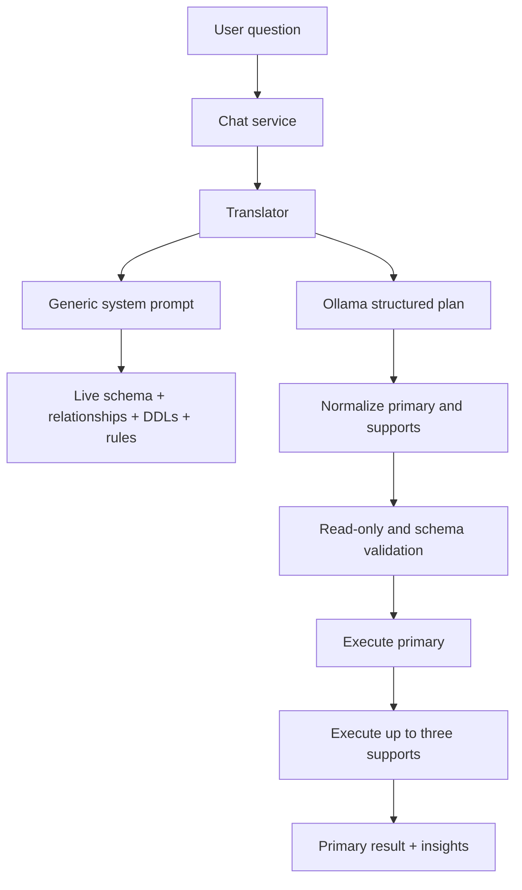

# Schema-Driven Query Planning Design

**Spec**: `.specs/features/schema-driven-query-planning/spec.md`
**Status**: Approved

## Architecture Overview

The planner has one path. The API obtains the current schema context, the
prompter combines it with optional DDLs and business rules, and the translator
asks Ollama for a structured plan. No Python branch recognizes a business
entity or emits domain SQL.

## Components

### Generic prompt builder

- **Location**: `core/prompter.py`
- **Responsibility**: Encode portable analytical reasoning: inspect the
  available entities, identify measures and dimensions, use declared
  relationships, resolve explicit periods from the reference date, and avoid
  invented identifiers.
- **Boundary**: It may describe SQL and analytical strategies, but it must not
  name a business table, column, status, or metric.

### LLM translator

- **Location**: `core/translator.py`
- **Responsibility**: Always send the question and conversation context to
  Ollama, then parse the structured response.
- **Boundary**: It does not inspect question vocabulary or generate SQL.

### Runtime schema introspection

- **Location**: `database/postgres.py`
- **Responsibility**: Return tables, columns, comments, and foreign-key
  relationships from the current PostgreSQL database.
- **Boundary**: It reports metadata only; it does not choose queries.

### Existing plan executor

- **Location**: `api/services/chat.py`
- **Responsibility**: Remains unchanged as the safety and execution boundary.
  It validates and bounds primary/supporting queries and maps results to the
  existing insight contract.

## Data Flow

1. The dependency builds a translator from the current schema context.
2. The prompt includes a reference date and generic period rules.
3. The model chooses identifiers only from schema/DDL/rule context.
4. The translator normalizes the optional support list to three entries.
5. The chat service performs the existing read-only and execution checks.

## Error Handling

- Ollama failures continue to surface as translator errors.
- Malformed structured responses continue to raise the existing parsing error.
- Invalid SQL remains rejected by the existing chat service before execution.
- A failed supporting query remains an explicit insight warning while a
  successful primary result is preserved.

## Verification Strategy

- Unit tests prove the translator always dispatches to Ollama, including a
  question that previously matched the sales fast path.
- Prompt tests assert generic strategy requirements and the absence of former
  domain entities.
- PostgreSQL adapter tests assert foreign-key metadata formatting.
- Existing API service and frontend tests cover the unchanged execution and
  insight contracts.
