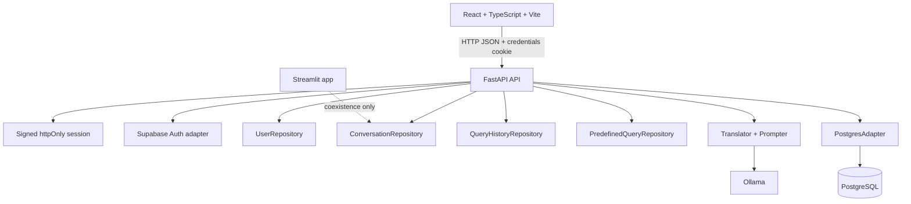

# Web Frontend Migration Design

**Spec**: `.specs/features/web-frontend-migration/spec.md`  
**Status**: Draft

## Architecture Overview

The migration adds a FastAPI application and a React + TypeScript + Vite SPA beside the existing Streamlit entry point. The API owns authentication, authorization, orchestration, serialization, and read-only SQL execution. Existing repositories and core services remain the source of truth until the final cutover.



### Alternatives considered

| Approach | Advantages | Costs | Decision |
| -------- | ---------- | ----- | -------- |
| React + Vite SPA with FastAPI | Small client bundle, explicit browser state, easy API tests, no full-page rerun | Requires a separate API and frontend toolchain | **Selected** |
| Next.js with FastAPI | SSR and routing conventions | SSR is unnecessary for an authenticated internal tool and adds deployment/runtime complexity | Rejected |
| Vue or Svelte with FastAPI | Good SPA ergonomics | Less aligned with the user's requested JavaScript ecosystem and the planned React test/tooling surface | Rejected |

## API Boundaries

### Authentication

| Method | Route | Auth | Behavior |
| ------ | ----- | ---- | -------- |
| `POST` | `/api/auth/login` | Public | Validate credentials with Supabase, verify the local profile, issue the session cookie |
| `POST` | `/api/auth/signup` | Public | Create Supabase account and pending local profile |
| `POST` | `/api/auth/logout` | Authenticated | Revoke the server session and clear the cookie |
| `GET` | `/api/auth/me` | Authenticated | Return the current profile and role |

The browser uses `credentials: "include"` and never receives a bearer token. The API signs a compact session payload containing the Supabase user ID, issued-at timestamp, and expiry. The cookie is `HttpOnly`, `SameSite=Lax`, `Secure` in production, and has an eight-hour maximum age. Every authenticated request reloads the local profile so role and approval changes take effect without waiting for a client cache.

Mutating routes validate the `Origin` header against an explicit allowlist. CORS is restricted to the configured web origin and allows credentials only for that origin.

### Chat and SQL

The client sends a prompt and a generated request ID. It never sends SQL to the execute route. The server:

1. validates the prompt length;
2. persists the user message idempotently;
3. loads at most six prior turns;
4. calls the existing translator;
5. validates that the result is one read-only `SELECT` or `WITH` statement;
6. stores the generated SQL on the assistant message;
7. executes the stored SQL through `execute_read_only_query`;
8. serializes bounded results for JSON.

The execute route accepts the conversation and request IDs, not arbitrary SQL. It loads the stored assistant SQL and rejects missing, foreign, or non-read-only records.

### Resource routes

| Route family | Repository reused | Ownership/role rule |
| ------------ | ----------------- | ------------------- |
| `/api/conversations` | `ConversationRepository` | All reads and mutations use the authenticated user ID |
| `/api/query-history` | `QueryHistoryRepository` | All reads and mutations use the authenticated user ID |
| `/api/predefined-queries` | `PredefinedQueryRepository` | Read for approved users; create/update/delete for `dev`, `dba`, or `admin` |
| `/api/admin/users` | `UserRepository` | `admin` only; preserve last-admin guard |
| `/api/schema/sync` | translator/repository cache services | Approved users; rebuild translator schema and clear catalog cache |

## Backend Components

### `api/config.py`

- **Purpose**: Load typed runtime configuration from environment variables.
- **Interfaces**:
  - `Settings.web_origin: str`
  - `Settings.session_secret: str`
  - `Settings.session_max_age_seconds: int`
  - `Settings.cookie_secure: bool`
- **Dependencies**: `python-dotenv`; typed settings implementation selected during T1.
- **Reuses**: Existing environment names from `.env` and `core/auth.py`.

### `api/app.py`

- **Purpose**: Construct the FastAPI application, register routes, exception handlers, CORS/origin middleware, and request logging.
- **Interfaces**:
  - `create_app(settings, services) -> FastAPI`
- **Dependencies**: FastAPI, dependency providers, route modules.
- **Reuses**: Existing repository/service classes through factories.

### `api/auth/session.py`

- **Purpose**: Sign, verify, expire, issue, and clear the session cookie.
- **Interfaces**:
  - `issue_session(response, user_id)`
  - `require_session(request) -> SessionClaims`
  - `clear_session(response)`
- **Dependencies**: `SESSION_SECRET`; a maintained signing implementation selected during T1.
- **Invariants**: Invalid signature, missing cookie, malformed payload, and expiry all resolve to the same 401 error shape; secrets never enter logs.

### `api/auth/service.py`

- **Purpose**: Adapt Supabase email/password operations without a shared mutable client session.
- **Interfaces**:
  - `sign_in(email, password) -> AuthUser`
  - `sign_up(email, password, name) -> AuthUser`
  - `sign_out(user_id) -> None`
- **Dependencies**: Supabase Python client and `UserRepository`.
- **Reuses**: `SupabaseAuth` behavior from `core/auth.py`, with client creation isolated per operation.

### `api/dependencies.py`

- **Purpose**: Provide repositories, translator, current session, approved profile, and role guards to routes.
- **Interfaces**:
  - `get_current_profile(request)`
  - `require_approved_user(profile)`
  - `require_roles(*roles)`
  - `get_conversation_repository()`
  - `get_translator()`
- **Dependencies**: `api/config.py`, existing database/core modules.
- **Reuses**: Repository constructors and `Prompter`/`Translator` setup currently in `app.py:40-89`.

### `api/services/chat.py`

- **Purpose**: Orchestrate prompt persistence, translation, review state, retry idempotency, read-only validation, execution, and result serialization.
- **Interfaces**:
  - `translate_prompt(user_id, conversation_id, request_id, prompt)`
  - `execute_stored_query(user_id, conversation_id, request_id)`
  - `retry_request(user_id, conversation_id, request_id)`
- **Dependencies**: conversation, history, translator, and PostgreSQL repositories.
- **Reuses**: `persist_user_turn`, `save_assistant_turn`, `process_translation`, `process_query`, and `is_read_only_sql` behavior currently in `app.py:310-425` and `app.py:863-1035`, rewritten without Streamlit state.

### `api/serializers/results.py`

- **Purpose**: Convert pandas/scalar values to JSON-safe columns, rows, row count, and truncation metadata.
- **Interfaces**:
  - `serialize_dataframe(df, max_rows=5000) -> ResultPayload`
- **Dependencies**: pandas, standard-library date/decimal handling.
- **Invariants**: null-like values become JSON null; dates become ISO-8601 strings; Decimal values become strings; rows are bounded.

## Frontend Components

### `web/src/api/client.ts`

- **Purpose**: Centralize `fetch` defaults, credentials, typed responses, error normalization, and 401 handling.
- **Interfaces**:
  - `api<T>(path, options): Promise<T>`
  - typed methods for auth, conversations, chat, history, catalog, admin, and sync.
- **Invariants**: no token is stored in localStorage/sessionStorage; mutating requests use the configured origin and credentials.

### `web/src/app/AuthProvider.tsx` and `web/src/app/Router.tsx`

- **Purpose**: Load `/api/auth/me`, expose auth state, and render exactly one auth or application branch.
- **Invariants**: login success changes state without duplicating the auth tree; 401 clears the authenticated branch; pending/disabled profiles cannot reach the chat.

### `web/src/features/auth/`

- **Purpose**: Render controlled login/signup forms, validation, inline errors, and sign-out.
- **Invariants**: password is cleared after failed login; submit controls are disabled only for the active request; labels and keyboard behavior are explicit.

### `web/src/features/conversations/`

- **Purpose**: Show grouped private conversations, create/open/favorite/delete actions, empty state, and mobile sidebar behavior.
- **Dependencies**: typed API client and chat state.
- **Reuses**: grouping semantics from `grouped_sessions` in `app.py:273-305`.

### `web/src/features/chat/`

- **Purpose**: Render messages once, compose prompts, show pending/error/retry/review states, display bounded results, charts, and CSV downloads.
- **Dependencies**: typed API client; Recharts for bar/line charts.
- **Invariants**: request IDs are stable across retries; prior messages remain mounted while a request is pending; no raw client SQL is sent to execution.

### `web/src/features/history/`, `web/src/features/predefined/`, `web/src/features/admin/`, `web/src/features/settings/`

- **Purpose**: Preserve the existing history, shared-query, administration, and schema-sync capabilities as independently testable panels.
- **Dependencies**: typed API client and role-aware route guards.

## Data Models

### SessionClaims

```typescript
interface SessionClaims {
  userId: string
  issuedAt: number
  expiresAt: number
}
```

### Profile

```typescript
interface Profile {
  id: string
  email: string
  name: string
  role: "user" | "dev" | "dba" | "admin"
  status: "pending" | "approved" | "rejected" | "disabled"
}
```

### ChatMessage

```typescript
interface ChatMessage {
  requestId: string
  role: "user" | "assistant"
  content: string
  sql?: string
  error?: string
  retryable?: boolean
  retryKind?: "translate" | "execute"
  chart?: ChartSpec
  result?: ResultPayload
}
```

### ResultPayload

```typescript
interface ResultPayload {
  columns: string[]
  rows: Array<Record<string, unknown>>
  rowCount: number
  truncated: boolean
}
```

### ErrorEnvelope

```typescript
interface ErrorEnvelope {
  error: {
    code: string
    message: string
    field?: string
  }
}
```

## Error Handling Strategy

| Error scenario | API response | UI behavior |
| -------------- | ------------ | ----------- |
| Missing/invalid/expired cookie | 401 `auth_required` | Clear auth state and show login |
| Pending/rejected/disabled profile | 403 `account_not_approved` | Show status message and sign-out only |
| Invalid form or prompt | 422 with field/code | Keep the current screen and show inline validation |
| Foreign conversation/history record | 404 | Show not-found feedback without changing current chat |
| Forbidden role action or bad origin | 403 | Show authorization feedback; do not retry automatically |
| Non-read-only or missing stored SQL | 422 `sql_not_read_only` | Keep review state and show a retryable/non-executable error |
| Ollama unavailable | 502 `translator_unavailable` | Store an assistant error with retry |
| PostgreSQL/storage unavailable | 503 `database_unavailable` or `storage_unavailable` | Preserve the user message and show retry guidance |
| Unexpected server error | 500 `internal_error` | Show a generic message; log correlation ID, never stack trace to client |

## Code Reuse Analysis

| Existing component | Location | Migration use |
| ------------------ | -------- | ------------- |
| Supabase email/password adapter | `core/auth.py` | Wrap in `api/auth/service.py`; remove Streamlit-specific ownership |
| Prompt builder | `core/prompter.py` | Reuse unchanged in translator factory |
| Ollama translator and JSON parser | `core/translator.py` | Reuse unchanged behind chat service |
| PostgreSQL adapter | `database/postgres.py` | Reuse with the read-only method for every exposed execution |
| Private conversation repository | `database/conversations.py` | Reuse owner-scoped CRUD, ordering, favorites, expiry, and bounded context |
| Query history repository | `database/query_history.py` | Reuse user-scoped history and conversation linkage |
| Shared query repository | `database/predefined_queries.py` | Reuse validation, parameters, favorites, and role checks |
| User repository | `database/users.py` | Reuse profile lookup, roles, status, and last-admin protection |
| Streamlit behavior tests | `test_*.py` | Keep as regression evidence while API and frontend tests are added; delete only at cutover |

## Risks & Concerns

| Concern | Location | Impact | Mitigation |
| ------- | -------- | ------ | ---------- |
| UI, orchestration, and persistence are coupled in one script | `app.py:109-1130` | Direct translation would reproduce implicit rerun state and duplicate side effects | Extract API services with explicit request IDs and typed response states before frontend parity |
| Chat execution currently calls a write-capable adapter | `app.py:995-1008`, `database/postgres.py:44-66` | A remote endpoint could execute destructive SQL | Enforce `SELECT`/`WITH` validation and `execute_read_only_query` in the API service |
| Supabase client is cached as a Streamlit resource | `app.py:40-47`, `core/auth.py:15-27` | Shared mutable auth state can leak across API requests | Create an API-scoped adapter with operation-local client state and signed server cookie |
| Result rows are stored in pandas objects in session state | `app.py:349-421` | JSON serialization and browser memory can become unbounded | Serialize at 5,000 rows, expose `truncated`, and do not persist result rows |
| Existing tests are Python/Streamlit only | `test_app.py`, `test_chat_ui.py` | API/frontend regressions would be invisible | Add route integration tests, React unit tests, and Playwright E2E gates before cutover |
| No JS manifest or lint/build configuration exists | repository root | New commands can drift or become undocumented | T7 creates one authoritative `web/package.json` with check/build/e2e scripts |

## Tech Decisions

| Decision | Choice | Rationale |
| -------- | ------ | --------- |
| Frontend | React + TypeScript + Vite | Explicit SPA state without Streamlit reruns; no SSR requirement |
| Server state | Typed API client plus TanStack Query | Request caching/invalidation belongs in the client layer, not component-local duplication |
| Client routing | React Router | Authenticated and public branches are explicit and testable |
| Charts | Recharts | Covers current bar/line behavior without recreating chart primitives |
| API tests | FastAPI TestClient with fake repositories | Tests route contracts and auth boundaries without requiring external services |
| Browser tests | Playwright | Measures duplicate DOM nodes during login and chat transitions in a real browser |
| Session cookie | Signed httpOnly SameSite=Lax | Avoids token storage in browser JavaScript while supporting the local SPA/API setup |

## Verification Strategy

1. Run existing Python regression tests after every backend task.
2. Run API unit and TestClient tests after each API task.
3. Run frontend typecheck/lint/unit tests after each frontend task.
4. Run Playwright E2E for auth and chat transitions before claiming MVP parity.
5. Run the full build and both local start commands before cutover.
6. Dispatch a fresh Verifier after the last task; the Verifier must run the discrimination sensor and write `validation.md`.

## Research References

- FastAPI response cookies: <https://fastapi.tiangolo.com/advanced/response-cookies/>
- Vite production build: <https://vite.dev/guide/build>
- React state management: <https://react.dev/learn/managing-state>
- Supabase Python password sign-in: <https://supabase.com/docs/reference/python/auth-signinwithpassword>
